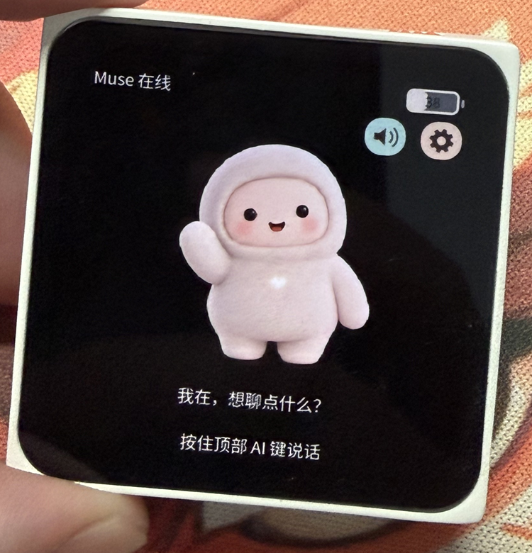

# Muse Charm · Mosaico

基于 Muse Gadget SDK 的 ESP-Mosaico 语音 AI 伙伴，支持按键对话、千问语音朗读、八种角色动态、中英文界面与手机 Wi-Fi 配置，也能通过 Muse 生成并更换角色形象。


[English](README_EN.md) · [手机配置图文教程](docs/SETUP_CN.md) · [构建](docs/BUILDING.md) · [生成角色](docs/CHARACTERS_CN.md)

## M5Stack CoreS3 适配

CoreS3 使用独立工程 [`projects/muse_companion_cores3`](projects/muse_companion_cores3/README.md)，
采用板载屏幕、触摸、麦克风和喇叭驱动，界面为 320×240。按住屏幕说话按钮录音，松开发送；
配对时点此按钮确认。此版本暂未接入电量显示和运动唤醒。
CoreS3 的构建和烧录步骤见该工程说明，首次服务配置仍可参考手机配置教程。

## 实机演示

[](https://github.com/samyeei/Muse-charm-mosaico/raw/refs/heads/main/docs/assets/demo/muse-charm-demo.mp4)

[观看／下载演示视频](https://github.com/samyeei/Muse-charm-mosaico/raw/refs/heads/main/docs/assets/demo/muse-charm-demo.mp4) · 约 39 秒，含声音。展示对话、角色动态与设置；视频已移除拍摄定位信息并遮挡背景顶部名称区域。

## 功能

- 黑底奶白色原创角色，待机、聆听、思考、朗读、困倦、错误、开心、开机八种动态。
- 上方 AI 键按住说话、松开发送；喇叭按钮静音；轻触角色触发开心动画。
- 默认阿里百炼 Qwen3-TTS-Flash-Realtime / Cherry；支持硅基流动和 OpenAI 兼容 PCM 语音接口。
- 首次启动连接设备免密码 Wi-Fi，浏览器填写 Muse token 与 TTS 地址、Key、模型和音色，保存后热点关闭。
- 中英文设置；音量、亮度、语速、自动翻页间隔、5/10/15/20/30/60 秒熄屏可调。
- 长回复自动翻页，触摸、AI 键和主板运动唤醒。
- 支持通过已配对的 Muse 生成新角色，在电脑预览后更新资源。

## 需要准备

ESP-Mosaico 裸机、USB 数据线、Muse 手机 App 与 Muse Gadget SDK token，以及阿里百炼 API Key（北京地域）或其他兼容 TTS 服务凭据。每位使用者填写自己的凭据，仓库与固件不包含作者的 token、配对和 Wi-Fi 数据。当前版本不需要扩展插件；不支持视频播放，自动环境光亮度尚未接入。

## 让本地 Agent 帮你安装

把设备通过 USB 数据线连接电脑，打开可访问本机 USB 的 Codex 或其他本地 Agent，直接发送下面这句话：

> 请将 https://github.com/samyeei/Muse-charm-mosaico 的最新版固件安装到我通过 USB 连接的 ESP-Mosaico：阅读仓库说明，自动下载代码、准备依赖并通过 mosaico.py 和仓库提供的完整固件包完成 system-update，保留设备身份、已有凭据与配对信息，不要整片擦除 Flash，安装后检查设备正常启动，并告诉我如何连接设备热点、打开 192.168.4.1 完成首次配置。

Agent 需要本地文件、网络与设备访问能力，可能会提示你授予权限或操作设备进入恢复模式。安装完成后，在手机配置页填写自己的凭据，详见 [手机配置图文教程](docs/SETUP_CN.md)。

## 直接安装

安装 Python 3.10+ 和 Git，获取代码后，在仓库根目录运行：

```powershell
python tools/bootstrap.py
python mosaico.py iris status --all --json
python mosaico.py iris list --project projects/muse_companion --details --json
```

对首次安装或未验证 Recovery 的设备，先运行 `python mosaico.py recover`，按工具提示操作。已有正常应用和可用 Recovery 时，可先通过 `python mosaico.py iris test enter-recovery --project projects/muse_companion --timeout 35` 进入 Recovery。

在 `projects/muse_companion` 目录安装预编译完整包：

```powershell
python ../../mosaico.py iris system-update --bundle "../../firmware/muse-charm-mosaico-v1.0.0.irisfw"
```

当前工具的 `--bundle` 不与 `--project` 或 `--skip-build` 同用。连接单台目标设备，更新保留 Recovery、设备身份和已有配对；不要使用整片擦除。详见工具依赖里的设备操作文档。

首次配置：手机连接屏幕显示的 `Mochi-Setup-XXXX`，无需密码，打开 `http://192.168.4.1`，填写服务配置；保存重启后通过 Muse App 配网和配对。设置里的“手机配置”可重新进入后台。

## 验证与限制

当前千问版本已在真机完成多轮录音、回复和朗读，用户确认电流音消失、声音顺滑。模拟器使用相同 C 界面，但模拟云服务和音频，不能代替真机验收。初始角色动态是姿态图片的位置动画；生成角色可使用逐帧动画。第三方 TTS 必须匹配支持的协议与 PCM 格式，填写任意地址不代表自动兼容。

## 开源与依赖

应用源码采用 Apache-2.0，第三方代码和字体保留各自许可证，见 [NOTICE](NOTICE)。基于 [ESP-Mosaico Vibe](https://github.com/esp-mosaico/esp-mosaico-vibe) 与 [Muse Gadget SDK](https://github.com/facebookincubator/muse-gadget-sdk)。构建依赖固定提交记录于 [DEPENDENCIES.json](DEPENDENCIES.json)。内部固件工程名保留 `muse_companion`，公开仓库名为 `muse-charm-mosaico`。
